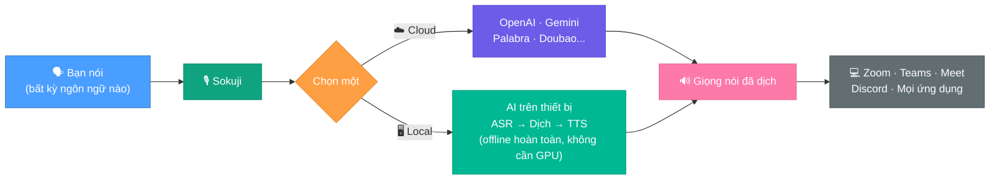

<p align="center">
  
</p>

<h3 align="center">Dịch giọng nói hai chiều theo thời gian thực cho các cuộc họp song ngữ — trên cloud hoặc hoàn toàn offline ngay trên thiết bị của bạn</h3>

<p align="center">
  <a href="../LICENSE" target="_blank">
    
  </a>
  <a href="https://github.com/kizuna-ai-lab/sokuji/actions/workflows/build.yml" target="_blank">
    
  </a>
  <a href="https://github.com/kizuna-ai-lab/sokuji/releases" target="_blank">
    
  </a>
  
  <a href="https://deepwiki.com/kizuna-ai-lab/sokuji" target="_blank">
    
  </a>
</p>

<p align="center">
  <a href="../README.md">English</a> | <a href="README.ja.md">日本語</a> | <a href="README.zh.md">中文</a> | Tiếng Việt
</p>

---

## Tại sao chọn Sokuji?

Được phát triển bởi [Kizuna AI Lab](https://github.com/kizuna-ai-lab) — chúng tôi dùng AI để phá bỏ rào cản ngôn ngữ và khả năng tiếp cận, tạo nên những kết nối thật sự giữa con người với nhau. "Kizuna" (絆) trong tiếng Nhật nghĩa là "sợi dây gắn kết", và Sokuji (即時 — "tức thì") là công cụ chủ lực của chúng tôi, giúp giao tiếp thời gian thực trở nên khả thi giữa mọi ngôn ngữ.

Sokuji là ứng dụng dịch giọng nói trực tiếp đa nền tảng cho máy tính và trình duyệt. Ứng dụng hỗ trợ **Local Inference** — nhận dạng giọng nói (ASR), dịch và chuyển văn bản thành giọng nói (TTS) ngay trên thiết bị nhờ WASM và WebGPU: không cần API key, không cần GPU đắt tiền, hoạt động hoàn toàn offline và riêng tư tuyệt đối. Sokuji cũng tích hợp với các nhà cung cấp cloud như OpenAI, Google Gemini, Palabra.ai, Kizuna AI, Doubao AST 2.0, Soniox và các API tương thích OpenAI.

---

## Cách hoạt động



| | |
|---|---|
| **Nhà cung cấp** | 8 — OpenAI, Gemini, Palabra.ai, Kizuna AI, Doubao AST 2.0, Soniox, OpenAI Compatible, Local Inference |
| **Mô hình local** | 44 mô hình ASR, 75 mô hình dịch, 137 mô hình TTS |
| **Ngôn ngữ** | 99+ (nhận dạng giọng nói) · 55+ (dịch) · 53 (chuyển văn bản thành giọng nói) |
| **Nền tảng** | Linux · Windows · macOS · Chrome · Edge |
| **Quyền riêng tư** | Local Inference = 100% trên thiết bị, không API key, không cần internet |

---

## Demo

https://github.com/user-attachments/assets/f48e2bee-4cad-4b40-b551-8ba59fb5652a

---

## Cài đặt

Sokuji có hai phiên bản: **Ứng dụng desktop** và **Tiện ích mở rộng trình duyệt** — tính năng như nhau, phạm vi sử dụng khác nhau.

| | Ứng dụng desktop | Tiện ích trình duyệt |
|---|---|---|
| **Tính năng** | Đầy đủ, giống hệt nhau | Đầy đủ, giống hệt nhau |
| **Dùng với** | Mọi ứng dụng có đầu vào micro — Zoom, Teams, Discord, Slack, game, OBS, v.v. | Các nền tảng họp trên web — Google Meet, Teams, Zoom, Yandex Telemost, Discord, Slack, Gather.town, Whereby, Jitsi Meet |
| **Cài đặt** | Tải về và cài đặt | Không cần cài — thêm từ cửa hàng |
| **Nền tảng** | Windows · macOS · Linux | Chrome · Edge · Brave (sắp ra mắt) |

### Ứng dụng desktop

Tải về từ [trang Releases](https://github.com/kizuna-ai-lab/sokuji/releases):

| Nền tảng | Gói cài đặt |
|----------|-------------|
| Windows | `Sokuji-x.y.z.Setup.exe` |
| macOS (Apple Silicon) | `Sokuji-x.y.z-arm64.pkg` |
| macOS (Intel) | `Sokuji-x.y.z-x64.pkg` |
| Linux (Debian/Ubuntu x64) | `sokuji_x.y.z_amd64.deb` |
| Linux (Debian/Ubuntu ARM64) | `sokuji_x.y.z_arm64.deb` |

### Tiện ích trình duyệt

<p>
  <a href="https://chromewebstore.google.com/detail/ppmihnhelgfpjomhjhpecobloelicnak?utm_source=item-share-cb" target="_blank">
    
  </a>
  <a href="https://microsoftedge.microsoft.com/addons/detail/sokuji-aipowered-live-/dcmmcdkeibkalgdjlahlembodjhijhkm" target="_blank">
    
  </a>
</p>

<details>
<summary>Cài tiện ích ở chế độ nhà phát triển (Developer Mode)</summary>

1. Tải `sokuji-extension.zip` từ [trang Releases](https://github.com/kizuna-ai-lab/sokuji/releases)
2. Giải nén file zip
3. Mở `chrome://extensions/` và bật "Developer mode"
4. Nhấn "Load unpacked" rồi chọn thư mục vừa giải nén

</details>

### Build từ mã nguồn

```bash
git clone https://github.com/kizuna-ai-lab/sokuji.git
cd sokuji && npm install
npm run electron:dev        # Phát triển
npm run electron:build      # Production
```

---

## Dịch hai chiều cho cuộc họp song ngữ

Hai người, hai ngôn ngữ, một cuộc trò chuyện. Sokuji tự động nhận biết
ngôn ngữ đang được nói và dịch sang ngôn ngữ còn lại — theo cả hai chiều,
theo thời gian thực. Chỉ cần đặt Ngôn ngữ A và Ngôn ngữ B, thu đồng thời
âm thanh hệ thống và micro, và mọi người đều theo kịp cuộc trò chuyện.

- **Tự động nhận diện ngôn ngữ** — không cần chuyển đổi thủ công giữa chừng
- **Cả hai chiều cùng lúc** — micro + âm thanh hệ thống trong một phiên duy nhất
- **Phụ đề trực tiếp** — chia sẻ màn hình để phía bên kia cũng đọc theo
- Hoạt động trong Zoom, Google Meet, Teams, Discord hoặc bất kỳ ứng dụng nào (desktop),
  và trực tiếp trong các nền tảng họp trên web (tiện ích trình duyệt)

> Vận hành bởi chế độ hai chiều của Soniox — 60+ ngôn ngữ, 3.600+ cặp ngôn ngữ.

---

## Tính năng

### Local Inference (Edge AI)

Chạy mọi thứ trên thiết bị của bạn — không API key, không cần internet sau khi đã tải mô hình, không cần GPU đắt tiền, riêng tư tuyệt đối. Nhờ WASM và WebGPU, Sokuji chạy hiệu quả trên mọi trình duyệt hiện đại, tận dụng CPU và card đồ họa tích hợp sẵn có.

- **44 mô hình ASR** (23 offline + 10 streaming + 11 WebGPU, gồm Whisper, Cohere Transcribe, Voxtral, Granite Speech) bao phủ 99+ ngôn ngữ
- **75 mô hình dịch** — 69 cặp ngôn ngữ Opus-MT + 6 LLM đa ngôn ngữ (Qwen 2.5 / 3 / 3.5, Hunyuan-MT 1.5, TranslateGemma) chạy bằng WebGPU
- **137 mô hình TTS** cho 53 ngôn ngữ (các engine Piper, Piper-Plus, Coqui, Mimic3, Matcha, MMS, VITS, Supertonic)
- Tải mô hình chỉ với một cú nhấp, lưu cache bằng IndexedDB

### Nhà cung cấp cloud

| Nhà cung cấp | Tính năng chính |
|--------------|-----------------|
| **OpenAI** | `gpt-realtime-mini` / `gpt-realtime-1.5` · 10 giọng · phát hiện lượt nói tùy chỉnh (Normal / Semantic / Disabled) · giảm nhiễu · 60+ ngôn ngữ |
| **Google Gemini** | Chọn mô hình động (audio/live) · 30 giọng · phát hiện lượt nói tích hợp · 34 biến thể ngôn ngữ |
| **Palabra.ai** | WebRTC độ trễ thấp · nhân bản giọng nói · tự động tách câu · dịch cả bản phiên âm tạm thời · 60+ ngôn ngữ nguồn / 40+ ngôn ngữ đích |
| **Kizuna AI** | Đăng nhập là dùng — API key do backend quản lý · cùng các mô hình OpenAI với cấu hình mặc định đã tối ưu |
| **Doubao AST 2.0** | Dịch giọng nói sang giọng nói, nhân bản giọng người nói · song hướng Trung↔Anh · đầu ra âm thanh Ogg Opus |
| **Soniox** | Dịch giọng nói sang giọng nói thời gian thực · **dịch một chiều & hai chiều (tự nhận diện ngôn ngữ người nói)** · 60+ ngôn ngữ / 3.600+ cặp · 200 giọng (lọc theo giới tính, độ tuổi, giọng vùng miền, mục đích, phong cách) · nhân bản giọng nói · dùng API key của riêng bạn |
| **OpenAI Compatible** | Dùng endpoint của riêng bạn — bất kỳ dịch vụ nào tương thích OpenAI Realtime API (chỉ trên Electron) |
| **Local Inference** | Hoàn toàn offline · ASR → Dịch → TTS trên thiết bị · không API key · không cần GPU |

### Âm thanh

- **Dịch giọng nói của bạn** — bạn nói bằng ngôn ngữ của mình, người khác nghe bản dịch như thể bạn nói tiếng bản xứ
- **Dịch giọng nói của người khác** — thu âm thanh cuộc họp (tiện ích) hoặc bất kỳ âm thanh hệ thống nào (desktop) và nhận phụ đề dịch theo thời gian thực
- **Micro ảo** — chuyển âm thanh đã dịch tới Zoom, Meet, Teams hoặc bất kỳ ứng dụng nào
- **Passthrough thời gian thực** — nghe lại giọng của chính mình khi đang ghi âm
- **Khử nhiễu bằng AI** — loại bỏ tiếng ồn nền, tiếng gõ phím và các âm thanh gây xao nhãng khác
- **Khử tiếng vọng (Echo Cancellation)** — tích hợp sẵn với Web Audio API hiện đại

### Giao diện

- **30 ngôn ngữ** — giao diện được bản địa hóa đầy đủ
- **Simple Mode** — thiết lập gọn nhẹ cho người dùng không chuyên kỹ thuật
- **Advanced Mode** — hiển thị dạng sóng âm và các tùy chỉnh chi tiết

---

## Quyền riêng tư

**Âm thanh của bạn ở lại trên thiết bị — nếu chọn Local Inference, âm thanh và văn bản không rời khỏi máy.**

- Chế độ cloud kết nối **trực tiếp** tới API của nhà cung cấp — không qua máy chủ trung gian
- API key **chỉ lưu cục bộ**, không bao giờ gửi cho chúng tôi
- Local Inference xử lý âm thanh và văn bản **trên thiết bị**; vẫn có request thống kê ẩn danh gửi tới PostHog
- Thống kê sử dụng ẩn danh qua PostHog

---

## Công nghệ sử dụng

- **Desktop**: [Electron](https://www.electronjs.org) (Windows, macOS, Linux)
- **Tiện ích**: Chrome/Edge Manifest V3
- **UI**: [React](https://react.dev) + TypeScript + [Zustand](https://zustand-demo.pmnd.rs/)
- **AI cục bộ**: [sherpa-onnx](https://github.com/k2-fsa/sherpa-onnx) (WASM) · [Transformers.js](https://github.com/huggingface/transformers.js) · WebGPU
- **Âm thanh**: Web Audio API · AudioWorklet · WebRTC
- **i18n**: [i18next](https://www.i18next.com/) (30 ngôn ngữ)

---

## Đóng góp

Chúng tôi luôn chào đón mọi đóng góp! Vui lòng đọc [Hướng dẫn đóng góp](../.github/CONTRIBUTING.md) trước khi bắt đầu.

---

## Giấy phép

[AGPL-3.0](../LICENSE)

## Nhà tài trợ

<table>
  <tr>
    <td><a href="https://signpath.org/"></a></td>
    <td>Ký số mã nguồn miễn phí trên Windows do <a href="https://about.signpath.io/">SignPath.io</a> cung cấp, chứng chỉ do <a href="https://signpath.org/">SignPath Foundation</a> cấp.</td>
  </tr>
</table>

## Hỗ trợ

- [Issues](https://github.com/kizuna-ai-lab/sokuji/issues) — Báo lỗi
- [Discussions](https://github.com/kizuna-ai-lab/sokuji/discussions) — Câu hỏi & ý tưởng

## Lời cảm ơn

- **Cloud API**: [OpenAI](https://openai.com), [Google Gemini](https://ai.google.dev), [Volcengine](https://www.volcengine.com)
- **ASR**: [sherpa-onnx](https://github.com/k2-fsa/sherpa-onnx), [OpenAI Whisper](https://github.com/openai/whisper), [SenseVoice](https://github.com/FunAudioLLM/SenseVoice), [Moonshine](https://github.com/usefulsensors/moonshine), [Cohere Transcribe](https://cohere.com), [Voxtral Mini 4B](https://github.com/mistralai)
- **TTS**: [Piper](https://github.com/rhasspy/piper), [Piper-Plus](https://github.com/ayutaz/piper-plus), [Matcha-TTS](https://github.com/shivammehta25/Matcha-TTS), [Coqui TTS](https://github.com/coqui-ai/TTS), [Mimic 3](https://github.com/MycroftAI/mimic3)
- **Dịch**: [Opus-MT](https://github.com/Helsinki-NLP/Opus-MT), [Qwen](https://github.com/QwenLM/Qwen), [TranslateGemma](https://github.com/google-research/translate-gemma)
- **Hạ tầng**: [Transformers.js](https://github.com/huggingface/transformers.js), [ONNX Runtime](https://github.com/microsoft/onnxruntime), [Electron](https://www.electronjs.org), [React](https://react.dev)

Chi tiết giấy phép của các mô hình xem tại [THIRD_PARTY_NOTICES.md](../THIRD_PARTY_NOTICES.md).
